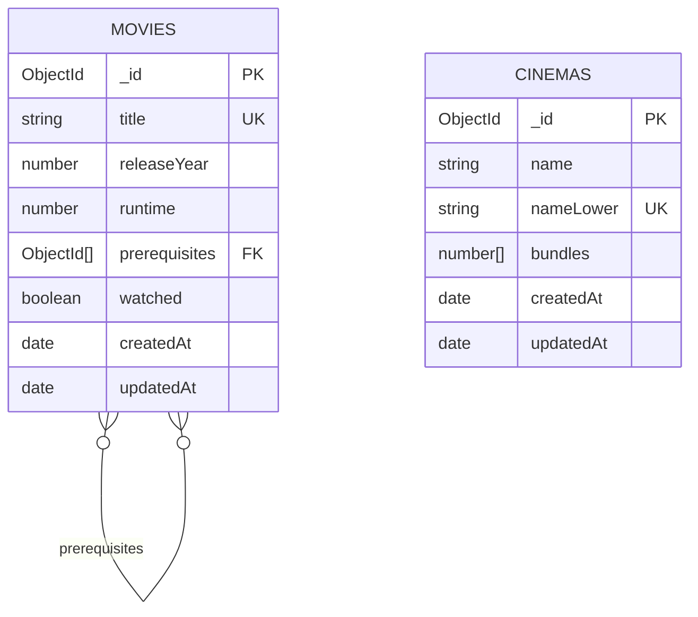

# Doomsday Ready

A full-stack application that helps MCU fans prepare for _Avengers: Doomsday_ by planning their movie rewatch order and calculating exact seat-bundle combinations for opening-night watch parties.

### Home Page


### Movies


### Rewatch Plan


### Watch-Party Booking


## Features

-Interactive error alerts using SweetAlert2

### 1. Movies

- Add movies with a unique title, release year, and runtime.
- Set prerequisite movies that should be watched first.
- Edit movie prerequisites.
- Mark movies as watched or unwatched.
- Prevent circular dependencies between movies.
- Validate movie information before saving.

### 2. Rewatch Plan

- Select a target movie.
- Automatically find all its direct and indirect prerequisites.
- Display movies in the correct viewing order.
- Show watched progress.
- Calculate the total remaining runtime of unwatched movies.

### 3. Cinema & Watch-Party Booking

- Add cinemas with unique names.
- Configure 1–10 different seat-bundle sizes.
- Enter a group size between 1 and 10,000.
- Calculate the minimum number of bundles required for an exact seat match.
- Display the quantity of each bundle size needed.
- Handle cases where an exact combination is not possible.

## Tech Stack

- **Frontend:** Next.js, React, TypeScript, Tailwind CSS
- **Backend:** Next.js API Routes
- **Database:** MongoDB
- **Database Connection:** Mongoose
- **Alerts & Notifications:** SweetAlert2

## Getting Started

### Prerequisites

- Node.js
- npm
- MongoDB Atlas account or a local MongoDB instance

### Installation

1. Clone the repository:

   ```bash
   git clone https://github.com/IztihadRafid/doomsday-ready
   ```

2. Navigate to the project directory:

   ```bash
   cd doomsday-ready
   ```

3. Install dependencies:

   ```bash
   npm install
   ```

4. Create a `.env.local` file in the project root:

   ```env
   MONGODB_URI=mongodb_connection_string
   ```

5. Start the development server:

   ```bash
   npm run dev
   ```

6. Open [http://localhost:3000](http://localhost:3000) in your browser.

## API Endpoints

### Movies

| Method | Endpoint                        | Description                            |
| ------ | ------------------------------- | -------------------------------------- |
| POST   | `/api/movies`                   | Create a movie                         |
| GET    | `/api/movies`                   | Get all movies                         |
| PATCH  | `/api/movies/:id`               | Update watched status or prerequisites |
| GET    | `/api/movies/:id/rewatch-order` | Get the prerequisite rewatch order     |

### Cinemas

| Method | Endpoint                               | Description               |
| ------ | -------------------------------------- | ------------------------- |
| POST   | `/api/cinemas`                         | Create a cinema           |
| GET    | `/api/cinemas`                         | Get all cinemas           |
| GET    | `/api/cinemas/:id/booking?groupSize=6` | Calculate a booking quote |

## Core Logic

### Movie Rewatch Order

The application uses a Depth-First Search (DFS) approach to traverse movie prerequisites.

- Finds direct and indirect prerequisites.
- Uses a visited set to avoid processing a movie more than once.
- Adds each movie after its prerequisites.
- Excludes the selected target movie from the result.
- Checks proposed prerequisite updates to prevent circular dependencies.

Circular dependency errors return HTTP `409` with the code `CIRCULAR_DEPENDENCY`.

### Booking Calculation

The application uses Dynamic Programming to find the minimum number of seat bundles required for an exact group size.

- Calculates the minimum bundles needed for each seat count.
- Stores the selected bundle size to reconstruct the final combination.
- Returns an impossible result if no exact combination exists.

No library is used to solve either of these core problems.

## Data Model

The application uses two MongoDB collections: `movies` and `cinemas`.



**Movies:** Each movie stores references to other movies that must be watched first.

**Cinemas:** Each cinema stores its available seat-bundle sizes.

## Assumptions

- Movie titles are unique.
- Cinema names are unique without considering letter case.
- A movie cannot depend on itself directly or indirectly.
- A booking must match the requested group size exactly.
- Cinemas can sell unlimited quantities of each available bundle size.
- Watched status is independent; movies can be marked watched regardless of prerequisite status.
- Authentication and user management are outside the scope of this assessment.

## AI Usage Disclosure

AI tools were used during development for guidance, code explanations, debugging assistance, and implementation support.

- **ChatGPT:** Used to understand programming concepts, discuss implementation approaches, explain algorithms, and troubleshoot issues.
- **OpenCode:** Used as an AI-assisted coding tool during development.

The implementation and code were reviewed and tested during development. The core movie dependency and booking logic were implemented with attention to understanding how the algorithms work.
